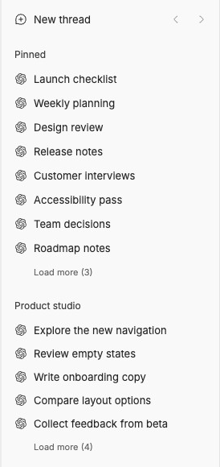
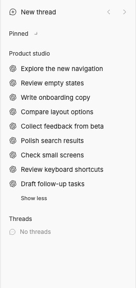

# Section Load More for BB

New development continues in [Sidebar Beautifier](https://github.com/docomoz/bb-plugin-project-section-folder), which includes the same Load more and Show less controls. This repository and its published releases remain available.

A fork of [Section Load More by siluthfi](https://github.com/siluthfi/bb-plugin-section-load-more)
for [BB](https://getbb.app). It shows the first 5 top-level threads in **Threads**
and in each custom section. **Pinned** starts at 8 and has its own adjustable
limit. **Load more** reveals 5 at a time by default. **Show less** restores the
initial limit. Both controls use an 11 px font, and **Load more** is muted
until hovered or focused.

The open thread stays visible, and child threads stay under their parent.

## Screenshots

| Initial limits in Pinned and a custom section | A section after Load more |
| --- | --- |
|  |  |

## Install

```sh
bb plugin install git:https://github.com/docomoz/bb-plugin-section-load-more.git@v0.1.3
```

Requires BB 0.50.1 or later and the built-in thread list. If another version
of Section Load More is active, disable it before using the fork.

## Settings

Open **Settings → Plugins → Section Load More**, or use the CLI.

```sh
bb plugin config section-load-more-fork set visibleThreads 5
bb plugin config section-load-more-fork set loadMoreStep 5
bb plugin config section-load-more-fork set limitPinnedThreads true
bb plugin config section-load-more-fork set visiblePinnedThreads 8
```

Turn off **Limit Pinned threads** to show all pinned threads. Pinned uses
the shared **Threads per Load more** setting.

How far a section is expanded is kept per window and resets on reload.

## How it works

The plugin registers an invisible app overlay
(`app.slots.experimental_appOverlay`) that decorates the built-in thread-list
plugin's DOM instead of replacing the list, so pinning, nesting, drag and
drop, menus, and status indicators keep working. `controller.ts` documents
the DOM it relies on (`[data-sidebar-section-id]`,
`[data-sidebar-visibility-group="threads"]`, `[data-sidebar-windowed-item]`).
If a bb update changes that markup, the plugin stops capping and the sidebar
behaves as it does without it.

Tested with BB 0.50.1.

## Development

```sh
bb plugin build
npm test        # node:test + jsdom, Node 22.18 or newer
```

## License

MIT
